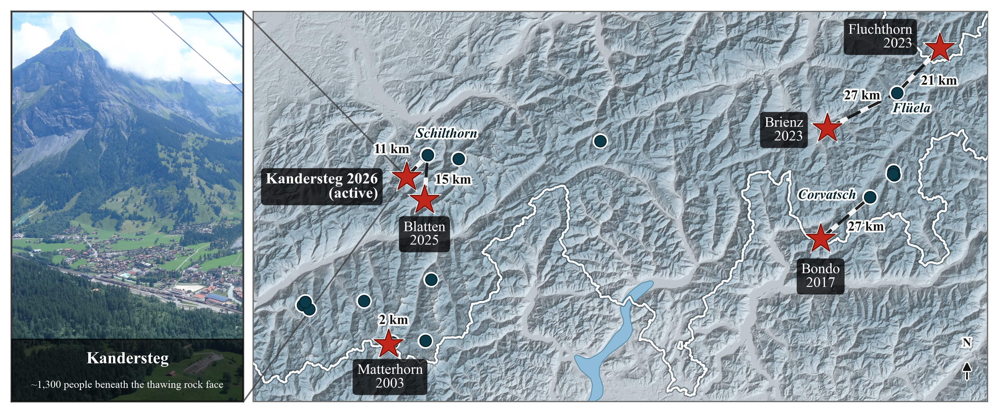
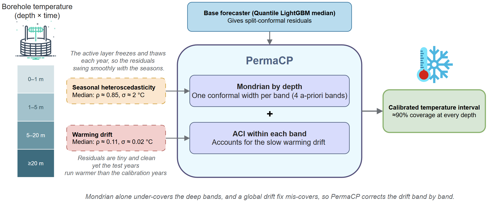
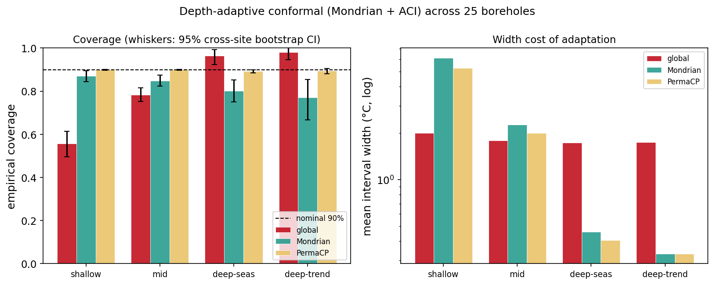

# PermaCP: Depth-Conditional Conformal Calibration for Permafrost Borehole Temperature

PermaCP puts calibrated prediction intervals, close to 90% coverage, on short-term forecasts of Alpine
permafrost borehole temperature. This repository holds the code, the processed data, the results, and the
figures. It accompanies a poster at the Tackling Climate Change with Machine Learning workshop at NeurIPS
2026.

<p align="center"></p>

The 25 PERMOS boreholes used here sit among recent permafrost-linked Alpine failures, each within roughly 2
to 27 km of a monitored site.

## Why intervals, not just forecasts

Mountain permafrost is warming, and its thaw has been tied to several recent Alpine rock-slope failures.
Borehole temperature is the signal people actually monitor. Once that signal drives a decision, say whether
the ground at foundation depth is about to pass 0 °C, a single predicted number says too little. What you
want is an interval you can rely on. PermaCP is about making that interval honest: it calibrates the
uncertainty rather than chasing point accuracy.

## One calibration cannot fit every depth

Forecast errors do not behave the same way up and down a borehole. Near the surface the ground freezes and
thaws every year, so the residuals swing with the seasons (about ρ = 0.85, σ = 2 °C). A single pooled
interval width is too narrow there and under-covers. A few metres down the ground barely moves from one day
to the next (ρ = 0.11, σ = 0.02 °C), so the same width is far too wide and over-covers. The deep ground also
drifts: the test years run warmer than the calibration years as the permafrost warms, which is exactly the
kind of shift that standard conformal prediction assumes away.

## How it works

PermaCP splits each borehole into four depth bands and calibrates every band on its own (Mondrian conformal
prediction, one interval width per band). Inside each band it then lets the width track the slow warming
over time (adaptive conformal inference, ACI). Neither half is enough alone. Depth bands without drift
tracking still leave the deep ground under-covered, and a single global drift correction pulls the shallow
and deep ends in opposite directions. Correcting the drift band by band is what keeps coverage honest
everywhere.

<p align="center"></p>

The base forecaster is a quantile LightGBM (median) and the nonconformity score is the absolute residual.
The four bands are shallow (below 1 m), mid (1 to 5 m), deep-seasonal (5 to 20 m), and deep-trend (20 m and
deeper).

## What the results show

Across the 25 qualifying PERMOS boreholes, at a nominal 90%:

| band | global | Mondrian (by depth) | PermaCP |
|------|:---:|:---:|:---:|
| shallow (<1 m) | 0.56 | 0.87 | **0.90** |
| mid (1–5 m) | 0.78 | 0.85 | **0.90** |
| deep-seasonal (5–20 m) | 0.97 | 0.80 | **0.89** |
| deep-trend (≥20 m) | 0.98 | 0.77 | **0.89** |

<p align="center"></p>

A single global calibration misses at both ends. Calibrating by depth fixes the shallow and mid bands but
leaves the deep band stuck near 0.77, because the warming drift breaks the exchangeability conformal
prediction relies on. PermaCP brings every band back to about 0.90, and it does so without widening the
intervals. The whiskers are 95% bootstrap confidence intervals taken across boreholes: PermaCP's bracket
0.90 in every band, while the baselines' sit clearly off it.

The result does not hinge on the particular settings. It holds when the band edges move, when the ACI step
size changes, across random seeds, at a 90-day horizon, under different missing-data handling, and across
temporal splits, and it holds at about 96% of individual sensors. On the warmest test days, where a hazard
call would actually be made, the baselines fall apart (Mondrian drops to 0.41) while PermaCP stays at 0.84.

## Reproducing the results

The processed data is included, so the pipeline runs without any download:

```bash
pip install -r requirements.txt

python src/run_adaptive.py          # the main result
python src/run_coverage_ci.py       # bootstrap confidence intervals
python src/run_band_sensitivity.py  # one of the robustness drivers
python src/make_figures.py          # redraw every data figure from results/*.csv
```

Every driver reads the same settings from `src/run_seed.py` (seed 42, nominal 90%, 30-day horizon, ACI step
0.03, a 60/20/20 split in time, the four depth bands). Runs are deterministic, and `src/ARCHITECTURE.md`
explains the choices.

## What is in here

```
src/
  conformal.py              global, Mondrian by depth, ACI, depth-normalized, CQR, AR(1) whitening
  features.py               lag, seasonality, depth and trend features
  model.py                  the shared base forecaster (quantile LightGBM)
  run_seed.py               the settings every driver shares, plus the train/cal/test split
  run_adaptive.py           the main result: Mondrian + ACI across 25 boreholes
  run_continuous.py         a continuous depth-normalized alternative
  run_reliability.py        coverage across nominal levels
  run_coverage_ci.py        cross-site bootstrap confidence intervals
  run_all.py                all 25 boreholes, with the landform breakdown
  run_subset.py             a 5-site replication
  stress_test.py            tail, thaw-zone and worst-site coverage, plus Winkler score
  analyze_domain.py         per-band accuracy against published permafrost methods
  gate_checks.py            data-premise diagnostics (variance by depth, drift, missingness)
  run_band_sensitivity.py   run_gamma_sweep.py        run_seed_robustness.py
  run_missing_robustness.py run_baselines.py          run_horizon.py
  run_cqr.py                run_per_sensor.py          run_temporal_splits.py
  make_figures.py           redraws every data figure from results/*.csv
  test_leakage.py           guardrail tests
  ARCHITECTURE.md           the settings, the shared contract, and why each choice was made
data/
  borehole_all_long.parquet     the 25 boreholes (site_id, date, depth_m, temp_c, morphology)
  borehole_subset_long.parquet  the 5-site subset
  borehole_long.parquet         the single-site pilot (STO_6000)
  borehole_coords.csv           borehole coordinates
results/                        every CSV the figures are drawn from
figures/                        the paper and robustness figures
paper/DOMAIN_METHODS.md         ranked permafrost machine-learning methods, for context
```

## Data

The temperatures come from the PERMOS Database release 2025
([DOI 10.13093/permos-2025-01](http://dx.doi.org/10.13093/permos-2025-01)), collected by the Swiss
Permafrost Monitoring Network. The parquet files under `data/` are processed subsets of that release,
shared here under the [PERMOS Data Policy](https://www.permos.ch/fileadmin/Files/PERMOS_docs/PERMOS_DataPolicy_2023.pdf),
which allows open use as long as the source is cited. The usual caveats about gaps and sensor drift apply.
Please cite the data as:

> PERMOS 2025: PERMOS Database. Swiss Permafrost Monitoring Network, Davos and Fribourg, Switzerland.
> DOI:10.13093/permos-2025-01.

The Fig 1 map was composed outside this repository, so the code here does not regenerate it; the image is
committed under `figures/`.

## License

The code is under the MIT license (see `LICENSE`). The data under `data/` stays under the PERMOS Data Policy
and is not covered by the MIT license.
